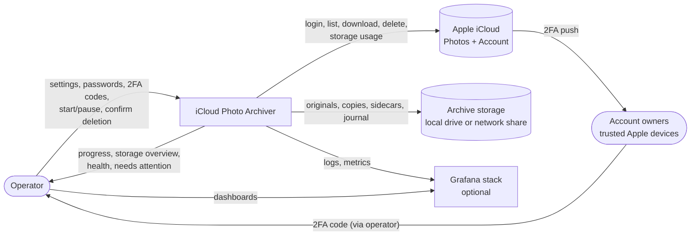
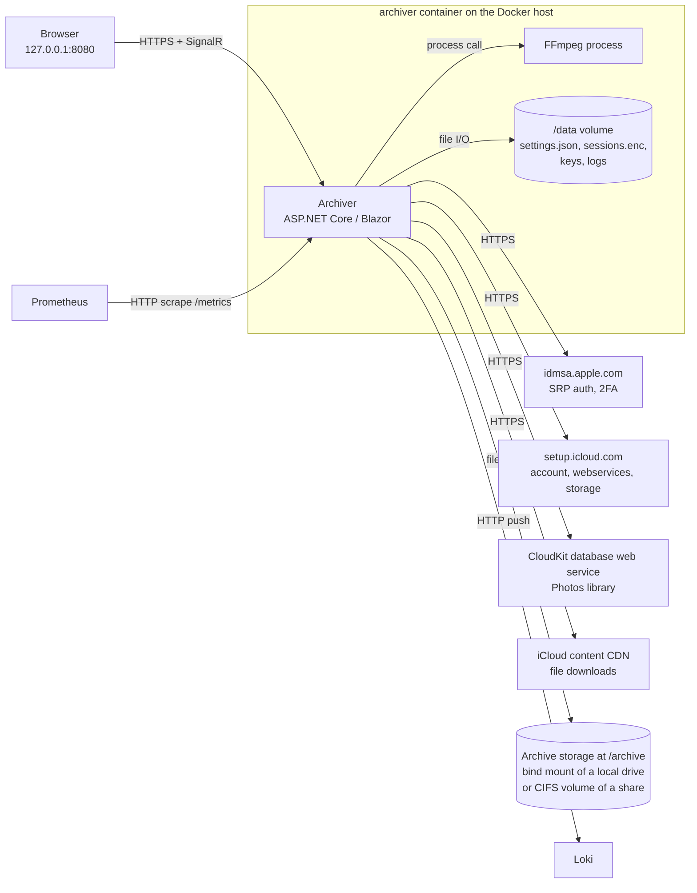

# 3. Context and Scope

## 3.1 Business context

| Partner | Input to the system | Output from the system |
|---|---|---|
| Operator | Account aliases, Apple ID, password (not stored), 2FA codes, master password, cutoff settings, run commands, deletion confirmation | UI: progress, storage overview, deletion plan, health, errors |
| Account owners | 2FA codes from their trusted devices, passed on by the operator | Photos older than the cutoff disappear from their devices (L-04) |
| Apple iCloud | Session tokens, asset lists and metadata, file contents, storage usage | Login requests, queries, download requests, delete requests |
| Archive storage | Free space, existing files (for verification) | Originals, viewable copies, XMP sidecars, journals |
| Grafana stack | – | Logs (Loki), metrics (Prometheus scrape) |

## 3.2 Technical context

| Channel | Technology | Notes |
|---|---|---|
| Browser ↔ App | HTTP(S), Blazor interactive server (SignalR) | Container port published on `127.0.0.1:8080` only; TLS via reverse proxy for LAN access |
| App → Apple authentication | HTTPS/JSON, SRP-6a, 2FA (trusted device code) | Endpoints to be confirmed in M1 |
| App → iCloud setup service | HTTPS/JSON | Account login, web service URLs, storage usage |
| App → CloudKit | HTTPS/JSON (`records/query`, `records/modify`) | Listing, metadata, delete. Private, undocumented. |
| App → content CDN | HTTPS, streamed download | Download URLs are short-lived; requested shortly before use |
| App → archive storage | File system API (`System.IO`) on `/archive` | Backed by a bind mount (local drive, e.g. `D:\PhotoArchive`) or a Docker CIFS volume (network share) |
| App → FFmpeg | Child process inside the container | Shipped in the image; path configurable for the development mode |
| App → Loki | HTTP push (Serilog Loki sink) over the compose network | Optional (profile `observability`) |
| Prometheus → App | HTTP scrape `archiver:9091/metrics` over the compose network | Optional; port not published |

## 3.3 Out of scope

Shared Albums, iCloud Shared Photo Library, Recently Deleted, re-upload to iCloud, scheduling, multi-user login. See product decisions §5.
