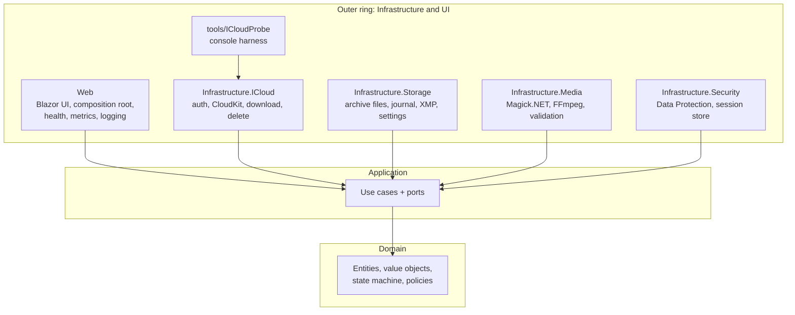
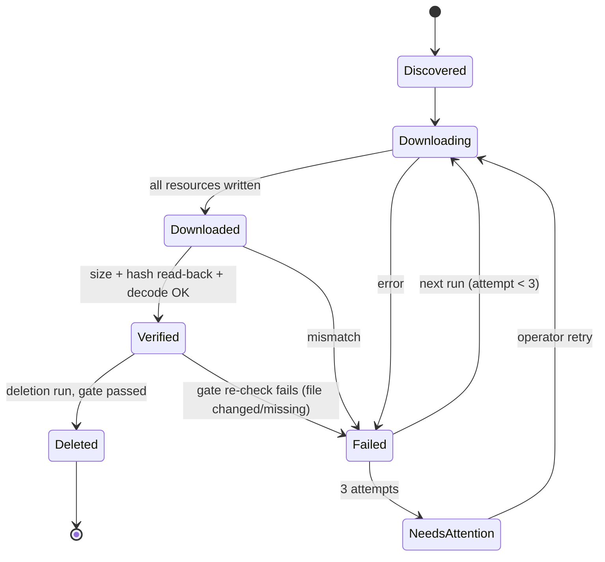

# 5. Building Block View

## 5.1 Level 1: Onion layers and projects



Dependency rule: **dependencies point inwards only.** `Domain` depends on nothing. `Application` depends only on `Domain` and defines the **ports** (interfaces). Infrastructure projects implement the ports. `Web` is the composition root and the only project that references all others. Enforced by `Architecture.Tests` (NetArchTest).

### Solution layout

```
icloud-photo-archiver/
├─ src/
│  ├─ PhotoArchiver.Domain/
│  ├─ PhotoArchiver.Application/
│  ├─ PhotoArchiver.Infrastructure.ICloud/
│  ├─ PhotoArchiver.Infrastructure.Storage/
│  ├─ PhotoArchiver.Infrastructure.Media/
│  ├─ PhotoArchiver.Infrastructure.Security/
│  └─ PhotoArchiver.Web/
├─ tools/
│  └─ ICloudProbe/
├─ tests/
│  ├─ PhotoArchiver.Domain.Tests/
│  ├─ PhotoArchiver.Application.Tests/
│  ├─ PhotoArchiver.Infrastructure.ICloud.Tests/
│  ├─ PhotoArchiver.Infrastructure.Storage.Tests/
│  ├─ PhotoArchiver.Infrastructure.Media.Tests/
│  ├─ PhotoArchiver.Web.Tests/
│  └─ PhotoArchiver.Architecture.Tests/
├─ deploy/
│  ├─ compose.yaml     (archiver; probe [profile tools]; loki, prometheus, grafana [profile observability])
│  ├─ .env.example
│  ├─ docker/
│  │  ├─ Dockerfile
│  │  └─ Dockerfile.probe
│  └─ observability/   (Prometheus, Loki, Grafana provisioning + dashboard)
├─ docs/
├─ Directory.Build.props
├─ Directory.Packages.props
├─ .editorconfig
└─ PhotoArchiver.slnx
```

## 5.2 Level 2: Building blocks

### Domain

| Element | Responsibility |
|---|---|
| `Account` | Alias (display name, used in UI/telemetry), Apple ID (sensitive), retention override, deletion-enabled switch |
| `MediaAsset` | iCloud asset ID, capture date, added date, media kind (photo, video, Live Photo), resources, metadata, state |
| `AssetResource` | One downloadable file of an asset: `Original`, `LiveVideo`, `Edited`; expected size, file name, UTI/extension |
| `AssetState` + transitions | State machine (§5.3); rejects invalid transitions (e.g. `Deleted` without `Verified`) |
| `RetentionPolicy` | Computes the cutoff date from global default + account override and `TimeProvider` |
| `EffectiveDate` | Capture date, fallback added date (D-02) |
| `ArchivePath` | Builds folder and file names (§8.4), resolves name collisions with an asset-ID suffix |
| `DeletionGate` | Pure rule: an asset may be deleted only if all resources are verified and their hashes still match |
| `AssetMetadata` | Albums, favorite, hidden, title, caption, location, edit info (D-14) |
| Journal events | `AssetDiscovered`, `ResourceDownloaded`, `ResourceVerified`, `ResourceFailed`, `CopyCreated`, `SidecarWritten`, `DeletionPlanned`, `AssetDeleted`, `AssetNeedsAttention`, … |

### Application

The Application layer follows a light CQRS split (ADR-017): **commands** change state by appending journal events, **queries** only read from in-memory read models. Both are plain use-case classes resolved via DI.

| Command | Responsibility |
|---|---|
| `SignIn` / `SubmitTwoFactorCode` / `RenewSession` | Drives the login flow, stores session tokens through `ISessionStore` |
| `DiscoverAssets` | Lists the library oldest-first up to the cutoff, appends `AssetDiscovered` for new assets |
| `RunArchive` | For each asset in state order: download → verify → sidecar; parallelism, pause/resume, cancellation |
| `CreateViewableCopies` | Separate step; never blocks verification or deletion (D-04) |
| `ExecuteDeletion` | Dry-run or real; re-checks the authoritative asset state from the journal and re-hashes each file before each delete; requires account switch on and operator confirmation |
| `RetryAsset` | Moves a needs-attention asset back to pending |

| Query | Responsibility | Read model |
|---|---|---|
| `GetAccountProgress` | Counts and sizes per state, current run status | `AccountProgressProjection` |
| `GetDeletionPlan` | Deletable assets (pass `DeletionGate` on the projected state) with count, size, date range | `DeletionCandidatesProjection` |
| `GetNeedsAttention` | Failed assets with reasons and attempt counts | `NeedsAttentionProjection` |
| `GetAssetHistory` | All journal events of one asset (answers "why is this still in iCloud?") | Journal (read directly) |
| `GetStorageOverview` | iCloud usage per account and per plan, archive storage, archive progress, plan suggestion | `AccountProgressProjection` + `IICloudStorageInfo` + `IArchiveFileStore` |
| `CheckHealth` | Results of all startup checks (D-17) | `IToolCheck` results |

**Read models** are in-memory projections per account. They are built when the journal is replayed at startup and updated synchronously by the journal's single writer right after each append, so queries never see outdated data. They are not persisted; the snapshot (§8.2) only speeds up the replay. Metrics (§8.6) are fed from the same projections.

| Port (interface) | Implemented in |
|---|---|
| `IICloudAuthenticator` | Infrastructure.ICloud |
| `IPhotoLibrary` (query, get download URL, delete) | Infrastructure.ICloud |
| `IICloudStorageInfo` | Infrastructure.ICloud |
| `IArchiveFileStore` (write atomically, read back, hash, set timestamps, free space) | Infrastructure.Storage |
| `IJournal` (append, replay, snapshot, notify projections) | Infrastructure.Storage |
| `ISidecarWriter` (XMP) | Infrastructure.Storage |
| `ISettingsStore` | Infrastructure.Storage |
| `IMediaValidator` (decodable?) | Infrastructure.Media |
| `IMediaConverter` (to JPEG / H.264) | Infrastructure.Media |
| `ISessionStore` (encrypted tokens) | Infrastructure.Security |
| `IToolCheck` (one per tool/resource) | each Infrastructure project |
| `IArchiverMetrics` | Web |

### Infrastructure.ICloud

| Element | Responsibility |
|---|---|
| `SrpClient` | SRP-6a handshake (`signin/init`, `signin/complete`) with PBKDF2-derived password key |
| `TwoFactorClient` | Requests/validates the trusted-device code, requests session trust |
| `ICloudSession` | Cookie container, session token, trust token, `dsid`, web service URLs; serializable |
| `CloudKitPhotosClient` | `records/query` on the primary sync zone (asset + master records, sorted by asset date ascending, separate query for Hidden); maps to `MediaAsset` |
| `AssetDownloader` | Streams a resource from its short-lived URL |
| `AssetDeleter` | `records/modify` marking the asset as deleted |
| `StorageUsageClient` | Account's iCloud usage and plan (total/used); for shared plans, the per-account breakdown if the API provides it (confirmed in M1) |
| `ICloudErrorMapper` | Maps HTTP/CloudKit errors to `SessionExpired`, `RateLimited`, `NotFound`, `Transient`, `Fatal` |

Exact endpoints, record types and field names are taken from the reference projects and **confirmed in M1**; they are configuration constants, not scattered literals.

### Infrastructure.Storage

| Element | Responsibility |
|---|---|
| `FileSystemArchiveStore` | Writes to `*.partial`, flushes, renames atomically; reads back for hashing; sets file times |
| `JsonlJournal` | One journal per account; append with flush; hash chain (`prevHash`) written on append and verified on replay (ADR-021); snapshot + compaction; lock file to prevent two instances |
| `ArchivePathGuard` | Verifies that every resolved path stays inside the archive root (§8.12) |
| `XmpSidecarWriter` | Writes `*.xmp` (Dublin Core, XMP basic, `lr:hierarchicalSubject` for albums, `xmp:Rating`/favorite) |
| `JsonSettingsStore` | `settings.json` in the local app data folder |

### Infrastructure.Media

| Element | Responsibility |
|---|---|
| `MagickImageValidator` / `FfprobeVideoValidator` | Proves a file decodes (image pings + decode; ffprobe stream check) |
| `MagickImageConverter` | HEIC/RAW → JPEG (quality ~95), keeps EXIF/GPS/ICC |
| `FfmpegVideoConverter` | HEVC → H.264 MP4 (CRF ~18, AAC), keeps metadata and creation time |
| `MagickSecurityPolicy` | Applies the restrictive ImageMagick policy (allowed formats, resource limits) at startup (§8.12) |
| `SafeProcessRunner` | Starts FFmpeg/ffprobe with `ArgumentList`, protocol whitelist, timeout and kill-on-cancel |
| `FfmpegToolCheck`, `MagickToolCheck` | Startup checks |

### Infrastructure.Security

| Element | Responsibility |
|---|---|
| `MasterPasswordXmlEncryptor` / `Decryptor` | Encrypts the Data Protection key ring with AES-GCM; key from master password via PBKDF2 |
| `ProtectedSessionStore` | Stores `ICloudSession` per account in `sessions/<alias>.enc` |
| `KeyRingUnlockService` | Holds the unlocked state in memory; app stays "locked" until the master password is entered |
| `MasterPasswordAuthenticator` | Login and step-up verification against the master password; rate limiting of failed attempts (ADR-019) |
| `PrivilegeGuard` | Refuses startup when the process runs privileged |

### Web

| Element | Responsibility |
|---|---|
| Pages | Dashboard (storage overview), Accounts (login/2FA, settings), Runs (start/pause/resume, live progress, log tail), Deletion (plan, dry-run, confirm), Needs attention, Health, Settings |
| `ArchiveRunner` (hosted service) | Executes runs in the background, one account at a time, independent of the browser connection |
| Composition root | DI registration, options validation, Serilog, Prometheus, health checks, localization, Kestrel endpoints (UI port + internal port), cookie authentication, security headers, HTTPS/HSTS behind a proxy |
| Pages: Login / Lock | Master-password login, manual lock; deletion dialog with step-up prompt |

## 5.3 Asset state machine



Viewable copy and sidecar have their own flags (`CopyCreated`, `SidecarWritten`). They are not part of the deletion gate, except that the sidecar must exist before deletion because it holds metadata that is lost with deletion.
