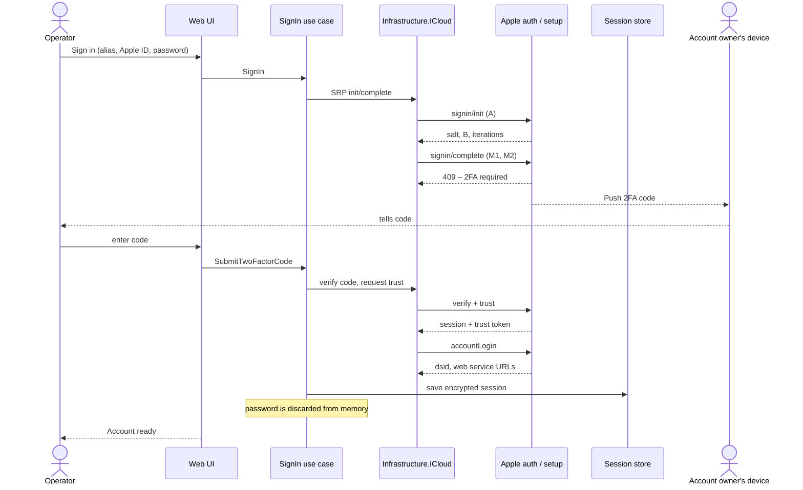
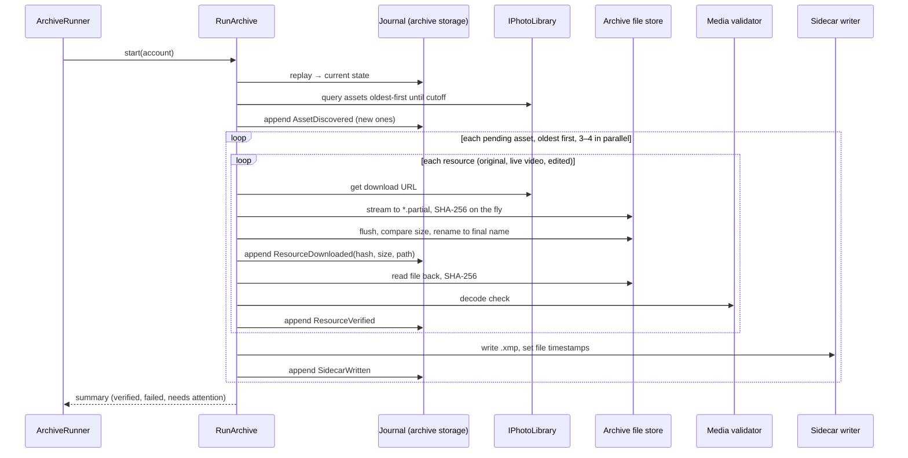
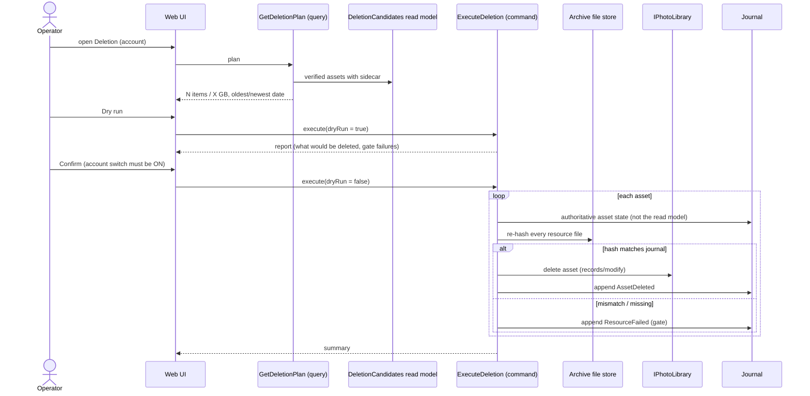

# 6. Runtime View

## 6.1 Sign-in with 2FA

When a stored session is still valid, the app reuses it without any prompt. When it expires (during a run or at startup), the account goes to **"re-login needed"** and its run pauses (D-12).

## 6.2 Archive run (one account)

Steps are **idempotent**: a crash between any two steps is repaired on the next run (§6.5).

## 6.3 Deletion run

Deleted items move to iCloud "Recently Deleted" and are purged by Apple after 30 days (D-08).

## 6.4 Creating viewable copies

A separate background step after verification. For each verified original that is HEIC/HEIF/DNG/RAW (→ JPEG) or HEVC/ProRes (→ H.264 MP4), the converter writes to `*.partial`, validates, renames, and appends `CopyCreated`. Failures go to the needs-attention list but never block deletion. If FFmpeg is missing, video copies are skipped and shown as "unavailable".

## 6.5 Crash and interruption recovery

| Interrupted after… | Found on restart | Repair |
|---|---|---|
| Partial download | `*.partial` file, no `ResourceDownloaded` | Delete partial, download again |
| Rename, before journal append | Final file exists, no journal event | Hash the file; if size matches expected, append `ResourceDownloaded` and continue with verification; otherwise re-download |
| `ResourceDownloaded`, before verification | Event exists, no `ResourceVerified` | Run verification |
| iCloud delete call, before `AssetDeleted` | Event missing | Query asset in iCloud: not found / deleted → append `AssetDeleted`; still present → retry |
| Journal line half-written | Last line not valid JSON | Ignore the broken trailing line on replay (it was never acknowledged) and log a warning |

## 6.6 Session expired or rate-limited during a run

The `ICloudErrorMapper` classifies the error. `Transient` → retry with exponential backoff (resilience pipeline). `RateLimited` → pause the account for a growing interval, then continue. `SessionExpired` → pause the account, set "re-login needed", show a banner; after the operator signs in again, the run can be resumed. The runner then continues with the next account if one is queued.
