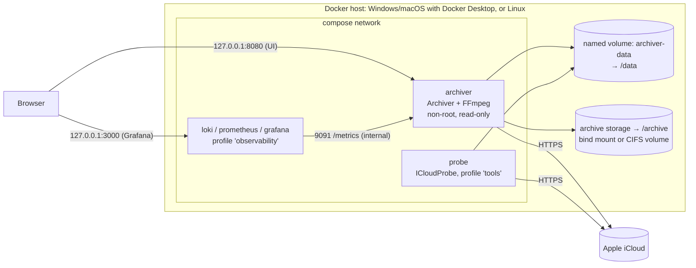

# 7. Deployment View

The app is delivered and run **as a Docker container from the first milestone on** (ADR-022). The same image runs on the operator's Windows PC or MacBook (Docker Desktop) and on any Linux Docker host (server, NAS). Running the app directly with `dotnet run` is only used for the development inner loop.

## 7.1 Container deployment (primary, from M0)

### Files in the repository

| File | Purpose |
|---|---|
| `deploy/docker/Dockerfile` | App image (multi-stage, Alpine, non-root) |
| `deploy/docker/Dockerfile.probe` | `tools/ICloudProbe` image (same base and hardening) |
| `deploy/compose.yaml` | All services: `archiver`; `probe` (profile `tools`); `loki`, `prometheus`, `grafana` (profile `observability`) |
| `deploy/.env.example` | Template for `deploy/.env` (git-ignored): archive path or share, UID/GID, Grafana admin password, image digests |
| `deploy/observability/…` | Prometheus and Loki config, Grafana provisioning and the pre-built dashboard |

### Usage

| Task | Command |
|---|---|
| Start the app | `docker compose -f deploy/compose.yaml up -d` → open `http://127.0.0.1:8080` |
| Start with observability | `docker compose -f deploy/compose.yaml --profile observability up -d` |
| Run the iCloud probe (M1, interactive 2FA) | `docker compose -f deploy/compose.yaml run --rm probe` |
| Update | `docker compose pull` / rebuild, then `up -d`; data and archive are in volumes and survive |

### Image (ADR-018, ADR-020)

- Multi-stage build on a **small Linux base image**:
  - Build stage: `mcr.microsoft.com/dotnet/sdk:10.0-alpine`, `dotnet publish -c Release -r linux-musl-x64` (and `linux-musl-arm64`), not self-contained.
  - Runtime stage: `mcr.microsoft.com/dotnet/aspnet:10.0-alpine` plus only `ffmpeg`, `icu-libs`, `tzdata`.
- Ends with `USER $APP_UID`: runs as the non-root `app` user, **never as root**.
- No SDK, shell tools or build artifacts in the final image. Target size: well under 250 MB.
- Multi-arch (amd64 + arm64), base images pinned by digest, updated by Dependabot.
- `HEALTHCHECK` calls the minimal `/healthz` liveness endpoint.

### Runtime (compose, §8.11)

- Explicit `user:`, read-only root file system with a `tmpfs` for `/tmp`, `cap_drop: [ALL]`, `no-new-privileges`, resource limits, `restart: unless-stopped`.
- UI port published on `127.0.0.1:8080` only; internal port `9091` (metrics, health details) never published.
- `/data` (named volume) and `/archive` are the only writable paths. `PHOTOARCHIVER__DATAROOT=/data`, `PHOTOARCHIVER__ARCHIVEROOT=/archive`.
- The app has its own login (master password, ADR-019). For LAN access, a reverse proxy terminates TLS; the app then enforces HTTPS and HSTS.

### Persistent data

| Data | Location in container | Backing |
|---|---|---|
| `settings.json` | `/data/settings.json` | Named volume `archiver-data` |
| Data Protection key ring (encrypted with master password) | `/data/keys/` | Named volume |
| Encrypted sessions | `/data/sessions/*.enc` | Named volume |
| Logs (rolling Serilog files) | `/data/logs/` | Named volume |
| Archive, journals, sidecars | `/archive` | Archive storage (see below) |

Directory mode `0700` for the app user. Nothing of this is ever inside the repository working tree; `.gitignore` additionally excludes `.env`, `settings*.json`, `*.enc`, `keys/`, `logs/`.

### Archive storage options

| Option | Configuration | Notes |
|---|---|---|
| **Local drive** (internal or external disk) | Bind mount, e.g. `ARCHIVE_PATH=D:/PhotoArchive` (Windows), `/Volumes/Photos/archive` (macOS), `/mnt/photos/archive` (Linux) | On Windows/macOS the folder must be shared with Docker Desktop (file sharing settings). On Linux the folder is owned by `APP_UID:APP_GID`. |
| **Network share (SMB)** | Named volume with Docker's built-in `local` driver and `type: cifs` (`vers=3.1.1`, `seal`, `uid`/`gid` of the app user), credentials of the **dedicated NAS account** from `.env` | Mounted by the Docker engine, **not inside the container** (the container keeps `cap_drop: [ALL]`). SMBv1 never. |
| Linux host with an existing mount (SMB/NFS) | Bind mount of the host mount point | Host mounts with the dedicated NAS account. |

### Platform notes

| Host | Notes |
|---|---|
| Windows | Docker Desktop with the WSL 2 backend. Bind mounts from Windows drives are slower than native disk I/O; acceptable for archiving (R-17). |
| macOS | Docker Desktop (VirtioFS file sharing). Apple silicon uses the arm64 image. |
| Linux / NAS | Docker Engine; rootless Docker or Podman recommended. |

Docker Desktop is free for personal use.

## 7.2 Development inner loop

For fast edit-run cycles the developer may run `dotnet watch` on the host (Windows/macOS/Linux). In that mode, data is stored in the user's app data folder (`%APPDATA%\PhotoArchiver`, `~/Library/Application Support/PhotoArchiver`, `~/.config/PhotoArchiver`) and Kestrel binds to `localhost`. This mode is **for development only**; real archive and deletion runs always use the container. The code therefore stays free of OS-specific dependencies (TC-2), and CI keeps testing it on all three OSes.

## 7.3 Observability stack (compose profile `observability`)

| Service | Purpose | Port | Published |
|---|---|---|---|
| `loki` | Receives logs pushed by Serilog's Loki sink | 3100 | No (compose network only) |
| `prometheus` | Scrapes `archiver:9091/metrics` | 9090 | No (compose network only) |
| `grafana` | Provisioned data sources (Prometheus, Loki) and the **pre-built "Photo Archiver" dashboard** | 3000 | `127.0.0.1:3000` only |

Provisioning files live in `deploy/observability/grafana/provisioning/` and the dashboard JSON in `deploy/observability/grafana/dashboards/photo-archiver.json`. The app works unchanged without the profile; the Loki sink is enabled only if a Loki URL is configured.

Security settings (§8.11): Grafana admin password from the git-ignored `.env`, anonymous access and sign-up disabled; all images pinned by digest, non-root, `cap_drop: [ALL]`, `no-new-privileges`, read-only root file systems where supported; Loki retention configured.

## 7.4 CI (GitHub Actions)

| Workflow | Trigger | Steps |
|---|---|---|
| `ci.yml` | push, pull request | Matrix `windows-latest` / `macos-latest` / `ubuntu-latest`: restore, build (warnings as errors), test, upload test results + coverage |
| `docker.yml` | push, pull request, tags | Build app and probe images (amd64 + arm64); verify they run as non-root; start `compose.yaml` and run the startup health checks inside the container; **Trivy** scan (fail on fixable HIGH/CRITICAL); generate SBOM + provenance; report image size. If published to GHCR later: cosign signature. |
| Dependabot | weekly | NuGet, GitHub Actions, Docker base images (app and observability stack) |

Workflow hardening (§8.11): actions pinned to commit SHAs, minimal `permissions:` per workflow/job, no `pull_request_target`, no secrets for fork PRs, protected `main` (green CI required, no force pushes). Secret scanning with push protection is enabled. Integration tests never call Apple; they use recorded fixtures.
