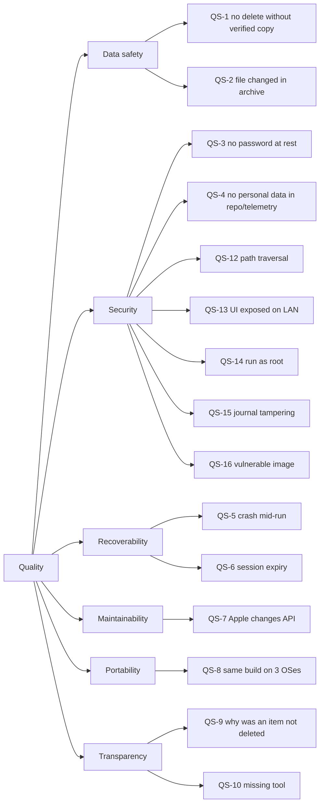

# 10. Quality Requirements

## 10.1 Quality tree

## 10.2 Quality scenarios

| ID | Scenario | Expected response | Measure |
|---|---|---|---|
| QS-1 | A download is truncated, but the HTTP call reports success | Size or hash check fails; asset stays `Failed`; never in a deletion plan | 0 deletions without `ResourceVerified` (enforced by domain state machine + tests) |
| QS-2 | An archived file is modified or removed in the archive storage after verification | Gate re-hash fails before deletion; asset not deleted; shown in needs attention | 100 % of deletions preceded by a successful re-hash |
| QS-3 | Someone copies the local app data folder | Without the master password, session tokens cannot be decrypted; no Apple passwords exist on disk | Code review + test that the session file contains no plaintext token |
| QS-4 | A contributor pushes to the public repo | No Apple IDs, tokens, real names or real fixture data in commits | Secret scanning + push protection; sanitized fixtures; masked IDs in logs |
| QS-5 | The PC loses power during a run with 4 parallel downloads | On restart: partial files removed, state rebuilt from journal, run resumes; no duplicate files, no lost progress beyond in-flight items | Recovery tests for each interruption point (§6.5) |
| QS-6 | An account's session expires at 3 a.m. during a run | Account pauses, banner "re-login needed", next account continues | Run summary shows paused state; no failed items caused by auth errors |
| QS-7 | Apple renames a CloudKit field | Change is limited to `Infrastructure.ICloud` (mapping + fixtures) | No changes outside that project needed |
| QS-8 | A push to `main` | CI builds and tests on Windows, macOS, Linux without OS-specific code paths | Green matrix required for merge |
| QS-9 | The operator asks why an old photo is still in iCloud | UI shows state and failure reasons from the journal (e.g. "hash mismatch, 3 attempts") | Every asset traceable from its journal events |
| QS-10 | FFmpeg is not installed | App starts; health page shows FFmpeg missing; video copies disabled; archiving and deletion still work | Health check test |
| QS-11 | Archiving 100 000 items | Startup replay < 10 s with snapshot; memory stays bounded (streams, no full-file buffering) | Measured in M7 |
| QS-12 | An iCloud asset has the file name `../../../etc/x` or `CON.HEIC` | Name is sanitized; resolved path is verified to be inside the archive root; nothing is written outside it | Path-containment tests with malicious names |
| QS-13 | The container's UI port is accidentally published on the LAN | Every page and hub requires login; a deletion additionally requires the master password; `/metrics` and health details are unreachable (internal port) | Integration tests: unauthenticated requests get 401/redirect; internal port not in published ports |
| QS-14 | Someone runs the app or container as root / Administrator | App refuses to start with a clear message | Startup test + CI check that the image's user is non-root |
| QS-15 | A line in the journal is edited on the share | Replay detects the broken hash chain; deletions for that account are locked; needs-attention alert | Tamper tests on the journal |
| QS-16 | A vulnerable base image or package is published upstream | CI fails on fixable HIGH/CRITICAL findings; Dependabot opens an update PR | Trivy in `docker.yml`, weekly Dependabot |
